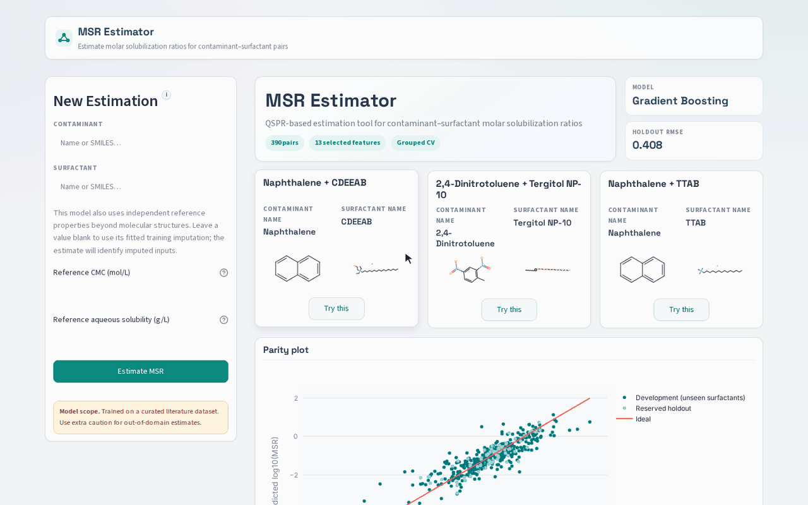

# msr-qspr

[](https://doi.org/10.5281/zenodo.24464885)
[](#)
[](LICENSE)
[](data/LICENSE.md)
[](environment.yml)
[](#prediction-and-screening)

<p align="center">
  
</p>

`msr-qspr` predicts the molar solubilization ratio (MSR, mol/mol) of hydrophobic
organic contaminants in aqueous surfactant solutions, for preliminary surfactant
screening in surfactant-enhanced aquifer remediation (SEAR). It compares
quantitative structure–property relationship (QSPR) procedures under grouped,
leakage-safe validation and provides model selection, applicability assessment,
interpretation, target randomization, holdout evaluation, surfactant screening and
a local prediction application. The response is `log10(MSR)`.

This repository contains the code and the complete scientific inputs of the study:

> Jara-Elizeche, J. M., Santos, A., Romero, A., Lorenzo, D. *Predicting molar
> solubilization ratios for resource-efficient surfactant selection in aquifer
> remediation.* DOI: pending.

## Repository contents

| Path | Contents |
| --- | --- |
| `msr_qspr/` | Workflow package, command-line interface and prediction application |
| `data/msr_dataset.xlsx` | Curated dataset: 459 MSR observations from 67 literature sources |
| `data/abraham/` | Abraham solute descriptors of all 52 contaminants and their provenance |
| `environment.yml`, `requirements.txt` | Pinned Python 3.12 environment |
| `LICENSE`, `data/LICENSE.md`, `data/abraham/LICENSE.md` | Software (MIT), MSR dataset (CC BY 4.0) and Abraham-descriptor (third-party) terms |
| `CITATION.cff` | Citation metadata |

## Data

**MSR dataset.** The frozen workbook `data/msr_dataset.xlsx` contains the 459
accepted observations in the `full_dataset` sheet, with molecular structures,
reference critical micelle concentrations (CMC), aqueous contaminant
solubilities, temperature metadata, source locations and a numbered
bibliography. Stable row IDs identify observations, and the workflow verifies
the workbook's SHA-256 before use. Measurements span heterogeneous assay
conditions, and nominal molecular graphs may approximate commercial materials.
Reference properties need not match the assay conditions. Temperature is
recorded but not used as a predictor.

**Abraham solute descriptors.** `data/abraham/descriptors.csv` holds the
descriptors E, S, A, B and V of every contaminant in the dataset, and
`data/abraham/provenance.csv` records the source of each row: 49 contaminants
from the UFZ-LSER compilation for CompTox users (2017), 2 UFZ-LSER QSPR
predictions, and 1 literature estimate (Tülp et al., 2008). The
`source_file` and `source_xlsx_row` columns refer to the UFZ-LSER export used
during curation. Both files are verified by SHA-256 before use; a different
directory can be supplied with `MSR_ABRAHAM_DIRECTORY`.

Please cite the original sources when reusing the data: the literature sources
listed in the workbook bibliography for MSR values; for Abraham descriptors, the
UFZ-LSER database (Ebert et al., *LSERD*, Zenodo, 2026,
[doi:10.5281/zenodo.22109107](https://doi.org/10.5281/zenodo.22109107)) and
Tülp et al. (2008), *Environ. Sci. Technol.* 42, 2034–2040,
[doi:10.1021/es702473f](https://doi.org/10.1021/es702473f).

## Installation

From the repository root, create the Python 3.12 environment:

```bash
conda env create -f environment.yml
conda activate msr-qspr
python -m pip install -e . --no-deps
```

Alternatively, use Python 3.12 and a virtual environment:

```bash
python3.12 -m venv .venv
source .venv/bin/activate
python -m pip install -r requirements.txt
python -m pip install -e . --no-deps
```

Run all commands from the repository root. The installed `msr-qspr` command is
equivalent to `python -m msr_qspr`; use `python -m msr_qspr <command> --help`
for stage-specific options.

## Quick start

Check input integrity and the grouped partitions, and list the computational
work units, without fitting any model:

```bash
python -m msr_qspr verify
python -m msr_qspr plan
```

Describe the dataset (figures, tables and a report; this reads all 459
responses, including the reserved holdout):

```bash
python -m msr_qspr characterize
```

## Reproducing the study

The predictive workflow runs in stages. Each stage verifies its inputs and the
outputs of the previous stage:

```bash
python -m msr_qspr compare              # grouped cross-validation of all candidates
python -m msr_qspr aggregate
python -m msr_qspr select
python -m msr_qspr fit                  # retune and refit the selected procedure
python -m msr_qspr interpret
python -m msr_qspr reliability
python -m msr_qspr randomize --permutations 99
python -m msr_qspr holdout --confirm-holdout
python -m msr_qspr report
```

`fit` writes the fitted bundle under `artifacts/final_model/`; `interpret`,
`holdout` and `screen` use it by default, or the directory given with
`--bundle DIR`. The complete study requires several hundred CPU-hours,
mostly in `compare` and `randomize`. Both stages split into independent work
units for parallel execution on any scheduler:

- `compare --scenario S --repetition R --outer-fold F --candidate C` runs one
  candidate × outer-fold unit; `plan` lists every unit as JSON without reading
  data. Scenarios are `unseen_surfactant`, `unseen_contaminant` and
  `unseen_study`.
- `randomize --permutation K --scenario S --repetition R` runs one target
  randomization unit (permutations `0` to `N-1`; three repetitions for the
  chemical axes, one for `unseen_study`); `randomize --permutations N
  --aggregate` then publishes metrics from all verified units.

When running units concurrently from one Python process, start workers with
the `forkserver` or `spawn` method rather than `fork`.

`report` rebuilds tables and figures from completed, verified stage outputs
without fitting or scoring the holdout again. `--stage NAME` builds one stage
only, and the command exits with a nonzero code if any output cannot be built.
`artifacts/INDEX.md` maps outputs to their sources.

## Prediction and screening

The application and `screen` need a fitted prediction bundle. Fit one with the
workflow above, or use the [published study outputs](https://doi.org/10.5281/zenodo.24463237):
extract the archive as `artifacts/` in the repository
root, then start the local prediction application:

```bash
python -m msr_qspr app
```

`python -m msr_qspr screen` ranks a CSV of candidate surfactants (`surfactant`,
`smiles`, `cmc`) for one contaminant by predicted MSR and weight solubilization
ratio (WSR), with applicability information. Pass `--save NAME` to retain a
case for the report; an existing case cannot be overwritten. When set, the
`MSR_BUNDLE_DIR` environment variable selects another bundle for both `app` and
`screen`.

Predicted MSR is an equilibrium solubilization capacity at reference
conditions, not a prediction of aquifer remediation performance. Supply CMC
values appropriate to the material and assay; a blank CMC uses the fitted
training-median imputation and is flagged in the applicability output. WSR uses
the molecular weight of the full supplied contaminant SMILES and, for the
surfactant, the supplied molecular weight if present, otherwise the full
supplied SMILES. This mass basis can differ from the main organic fragment used
for molecular descriptors, especially for salts.

Contaminants are matched to the curated Abraham table by structure, name or CAS
number. A structure with more than one unspecified stereocentre (for example
γ-hexachlorocyclohexane, CAS 58-89-9) resolves only through its curated name or
CAS number when the submitted structure matches the recorded graph. Uncurated
contaminants receive training-median imputation and an explicit status that
marks applicability as incomplete; an optional descriptor provider can supply
labelled estimates during prediction.

## Method summary

Twelve candidate procedures progress from reference properties to descriptor-rich
and physically informed models:

| Candidates | Representation | Estimators |
|---|---|---|
| `property_linear` | log CMC and log aqueous solubility | linear regression |
| `molecular_ridge`, `molecular_gb` | ranked molecular descriptors | Ridge, gradient boosting |
| `enriched_rf`, `enriched_gb`, `enriched_xgb` | ranked descriptors with CMC and solubility | random forest, gradient boosting, XGBoost |
| `physicochemical_ridge`, `physicochemical_gb` | eight compact physicochemical predictors | Ridge, gradient boosting |
| `solubility_anchored_gb` | compact predictors with a solubility anchor | gradient boosting |
| `abraham_anchored_ridge`, `abraham_anchored_gb` | compact predictors, Abraham descriptors and anchor | Ridge, gradient boosting |
| `abraham_hybrid_gb` | compact predictors, Abraham descriptors and anchor | Ridge-initialized gradient boosting |

The compact panel contains contaminant and surfactant molecular weight, SLogP and
topological polar surface area, CMC (mol/L) and aqueous solubility (g/L).
Ranked procedures select from 2D contaminant and surfactant descriptors and six
contaminant–surfactant pair descriptors. The solubility anchor fits
`log10(MSR) - beta * s`, with `s = log10(WaterSolubility / Cont_MW)` the log10
molar solubility after training-median imputation, and restores `beta * s` at
prediction; `beta` is tuned over {0, 0.5, 1}. Surfactant counterions are removed
before descriptor calculation.

A target-blind grouped split reserves 69 observations from 12 complete
surfactant groups for final evaluation and leaves 390 for development. Grouped
outer validation assesses unseen surfactants and unseen contaminants over three
repetitions each, with one complementary unseen-study repetition; each has five
outer folds. Tuning uses three surfactant-grouped and three contaminant-grouped
folds within each training partition. Imputation, descriptor selection and
tuning are fitted on training data only. Candidate selection minimizes the
worst relative deterioration in error across the two chemical axes.

Applicability assessment combines fitted input-space support, the training
response range and cross-fitted local error. Input-space support uses the
model's own fitted, training-standardized coordinates, grouped into contaminant,
surfactant and pair blocks of equal total weight, and compares each query with
the nearest training chemical groups against a training-derived threshold.
Queries whose inputs had to be imputed are marked incomplete rather than inside
the domain. Interpretation reports the imposed solubility offset separately from
learned contributions.

## Outputs and run identity

Outputs are written under `artifacts/`:

| Location | Contents |
| --- | --- |
| `characterization/` | Descriptive figures, tables and report |
| `comparison/` | Comparison metrics, diagnostics and selected model |
| `final_model/` | Fitted prediction bundle |
| `interpretation/`, `reliability/` | Selected-model interpretation and applicability results |
| `y_randomization/`, `holdout/`, `screening/` | Negative control, reserved evaluation and screening outputs |
| `workspace/` | Worker outputs, checkpoints and caches |

Run metadata record settings, seeds, input checksums, software versions and code
hashes, and every reused output is checked against them. Keep the numerical
environment and thread settings consistent when resuming a run. Inspect a run
without fitting using `python -m msr_qspr progress`. Every stage accepts
`--artifacts DIR` (default `./artifacts`) and `--workspace DIR` (default
`<artifacts>/workspace`) to choose output locations.

## Citation

If you use this software or its data, please cite the [software release](https://doi.org/10.5281/zenodo.24464886),
the [study outputs](https://doi.org/10.5281/zenodo.24463237) when used, and the
associated article when published (see `CITATION.cff`).

## License

The software is distributed under the [MIT license](LICENSE). The MSR dataset
(`data/msr_dataset.xlsx`) is distributed under the
[Creative Commons Attribution 4.0 International license](data/LICENSE.md). The
Abraham descriptors in `data/abraham/` are third-party values redistributed
under the terms of their original sources and are not covered by the CC BY 4.0
license; see [`data/abraham/LICENSE.md`](data/abraham/LICENSE.md).
